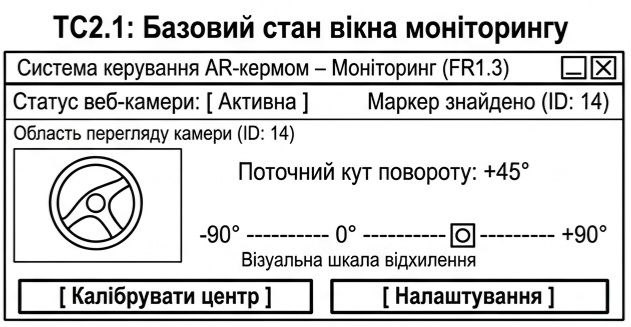
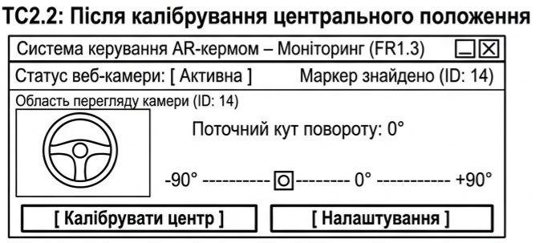
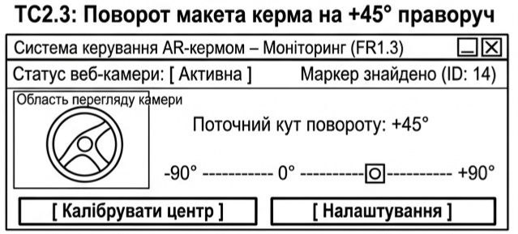

# Приймальні тестові сценарії нефункціональних вимог інтерфейсу користувача

## 1. Табличний опис приймальних тестових сценаріїв (NFR1.3 / GUI Моніторинг)

| NFR ID | Test Case ID | Опис кроків тестового сценарію | Опис очікуваних результатів |
| :--- | :--- | :--- | :--- |
| NFR1.3 | TC2.1 | **Початкові умови:** застосунок моніторингу AR-керма запущено, веб-камера підключена та розпізнала маркер `ID: 14`.<br>**Кроки сценарію:**<br>1) Перевірити наявність і розташування базових елементів вікна моніторингу. |  |
| NFR1.3 | TC2.2 | **Початкові умови:** успішно пройдено `TC2.1`, поточний кут повороту показує `+45°`.<br>**Кроки сценарію:**<br>1) Натиснути кнопку `[ Калібрувати центр ]` лівою кнопкою миші або натиснути гарячу клавішу `"C"`. |  |
| NFR1.3 | TC2.3 | **Початкові умови:** успішно пройдено `TC2.2`.<br>**Кроки сценарію:**<br>1) Повернути фізичний макет керма з AR-маркером на 45° праворуч перед веб-камерою. |  |

## 2. BDD-специфікація приймальних тестів мовою Gherkin

```gherkin
Feature: Візуальний моніторинг та керування інтерфейсом AR-керма (NFR1.3)
  As a Користувач (Водій)
  I want to бачити актуальний стан веб-камери, розпізнаного маркера та кута повороту на екрані і керувати калібруванням мишею або гарячою клавішею "C"
  So that контролювати точність керування в реальному часі без зайвого навантаження

  Scenario: Відображення всіх елементів екранної форми моніторингу
    Given застосунок моніторингу AR-керма запущено на ПК користувача
    And веб-камера підключена з роздільною здатністю не менше 720p
    When у кадрі розпізнано паперовий AR-маркер з ідентифікатором 14
    Then на екрані відображається статус веб-камери "Активна"
    And відображається повідомлення "Маркер знайдено (ID: 14)"
    And доступні активні кнопки "Калібрувати центр" та "Налаштування"

  Scenario: Калібрування центрального положення за допомогою гарячої клавіші "C"
    Given екранна форма моніторингу відкрита та маркер розпізнано
    And поточний кут повороту відображається як "+45°"
    When користувач натискає гарячу клавішу "C" на клавіатурі
    Then значення поточного кута повороту в інтерфейсі змінюється на "0°"
    And візуальна шкала відхилення встановлюється у центральне положення

Feature: Калібрування центрального положення керма
  As a Користувач
  I want to налаштувати нулеву точку (центр) для паперового керма
  So that система правильно визначала напрямок повороту ліворуч та праворуч

  Scenario: Успішне калібрування центрального положення
    Given користувач тримає макет керма з AR-маркером у рівному положенні
    And вебкамера підключена та транслює відеопотік
    When користувач натискає кнопку "Калібрувати центр"
    Then система фіксує поточний кут AR-маркера як 0 градусів
    And система виводить повідомлення "Калібрування успішно завершено"

Feature: Налаштування чутливості та мертвих зон
  As a Користувач
  I want to коригувати чутливість реагування керма
  So that уникнути тремтіння кадру та налаштувати зручність керування під себе

  Scenario: Встановлення мертвої зони для усунення тремтіння
    Given користувач відкрив вікно налаштувань контролера
    When користувач встановлює значення "Мертва зона" на 3 градуси
    And користувач повертає кермо на 2 градуси
    Then система ігнорує відхилення в межах 3 градусів і передає 0 градусів на віртуальну вісь